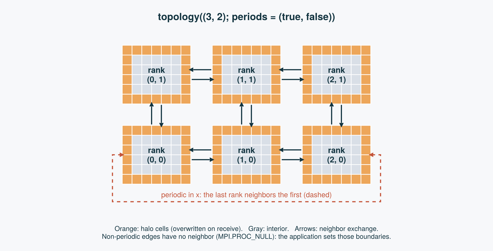

```@raw html
---
layout: home
hero:
  name: HaloGrids.jl
  text: Halo exchange with explicit grids.
  tagline: Build Cartesian MPI topologies, wrap local arrays, and exchange boundary data in Julia.
  actions:
    - theme: brand
      text: Get started
      link: /guide/getting-started
    - theme: alt
      text: Explore the API
      link: /api
features:
  - title: Explicit ownership
    details: Topologies own communicators. Grids own communication caches. Fields declare their halo widths.
  - title: Two or three dimensions
    details: Exchange multiple fields across Cartesian process layouts with periodic or nonperiodic boundaries.
  - title: Split-phase exchange
    details: Start an exchange, perform independent work, then finish the final dimension's communication.
  - title: Per-field halos and overlaps
    details: Each field declares its own halo width and overlap, so staggered and padded arrays share one grid.
  - title: Optional backends and I/O
    details: CUDA arrays (tested on hardware), AMDGPU arrays (untested), CellArrays, parallel HDF5-style checkpoints, and ParaView output load as extensions.
  - title: Reductions and coordinates
    details: Global sums, extrema, and norms, plus global index and coordinate helpers for each field.
---
```

## How it fits together

A `Topology` arranges MPI ranks on a Cartesian lattice. Each rank owns a local array
whose outer cells are halos, filled from its neighbors by `update_halo!`.



Continue with [Topologies, grids, and fields](./guide/concepts.md) for the model,
[Halo exchange](./guide/halo-exchange.md) for corners, face halos, and overlaps, or
[Hiding communication](./guide/hide-communication.md) for the split-phase API.

## Current scope

These pages describe the implementation in this checkout of version 0.1.0.
The examples use CPU arrays. `CuArray`/`ROCArray` fields work as drop-in
replacements wherever a `Field` wraps an array (see `ext/HaloGridsCUDAExt.jl`
and `ext/HaloGridsAMDGPUExt.jl`); the CUDA extension is tested against real
hardware, while the AMDGPU extension is a structurally identical port that has
not been run against real ROCm hardware yet. GPU halo buffers are staged through host memory
by default; `grid(...; gpu_aware_mpi=true)` passes them to a CUDA- or ROCm-aware
MPI directly (see [GPU arrays and GPU-aware MPI](./guide/gpu.md)). `save_hdf5`/`load_hdf5!` (see
`ext/HaloGridsHDF5Ext.jl` and the [MPI/HDF5 file I/O guide](./guide/hdf5-io.md))
write and read `Field` data to/from a shared HDF5 file once `HDF5` is loaded;
no parallel-HDF5 build is assumed, so ranks take turns writing rather than
writing simultaneously — see the guide for what that does and doesn't change
for the caller. `save_pvtk` (see `ext/HaloGridsWriteVTKExt.jl` and the
[Parallel ParaView (pvtk) I/O guide](./guide/pvtk-io.md)) writes `Field` data
to ParaView's parallel VTK XML image-data format once `WriteVTK` is loaded;
unlike `save_hdf5`, every rank writes its own independent file (no shared-file
write coordination needed), but halo cells are written rather than trimmed,
and periodic topologies are not yet supported.
